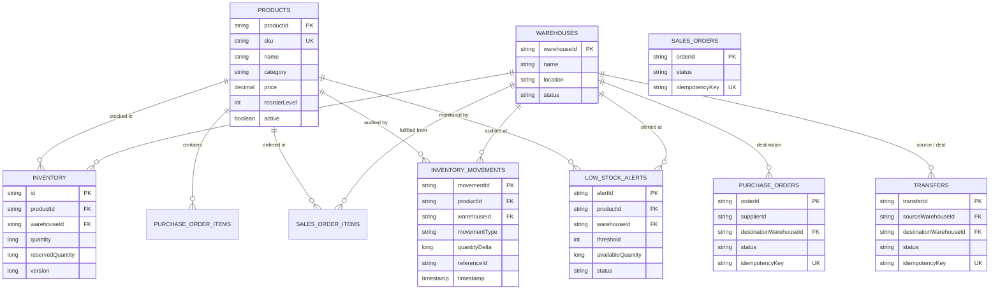

# Scalable Inventory Management System — Member 1: Core Inventory & Database Backend

This repository houses the core inventory and database backend for the System Design Laboratory project (**Topic 4: Scalable Inventory Management System**).

Developed by **Member 1: Core Inventory & Database**.

---

## 1. Member 1 Responsibilities & Backend Scope

Member 1 serves as the foundational backbone for the entire system design project. Members 2–5 depend on Member 1's data models, persistence interfaces, and core business logic:

- **Database Schema & Models:** Designed all MongoDB collections, document schemas, unique indexes, and referential integrity rules.
- **Product & Warehouse Master Data:** Registration, validation, category indexing, warehouse management, and stock visibility.
- **Inventory Consistency & Atomic Updates:** Conditional atomic reservation/deduction to guarantee zero overselling and no negative inventory under high concurrency.
- **Purchase & Sales Order Workflows:** Incoming stock receipt accounting, multi-item sales reservation with Saga compensation rollback, and idempotency protection.
- **Warehouse-to-Warehouse Stock Transfers:** Safe multi-stage transfers with explicit state tracking (`IN_TRANSIT`) preventing double-spending or stranded inventory.
- **Low-Stock Alerting:** Threshold monitoring with deduplication to prevent repetitive notifications, plus automatic resolution upon restocking.
- **Audit Trails:** Immutable append-only movement logs tracing every stock change.
- **Integration Ports:** Decoupled persistence, cache, ID generation, and crawler interfaces for Members 2, 3, and 5.

---

## 2. Team Architecture & Component Boundaries

```
                      +-----------------------------+
                      | Member 4: React UI / Client |
                      +--------------+--------------+
                                     | REST (JSON)
                                     v
+---------------------+   +--------------------------+   +---------------------+
| Member 3: ID Gen    |-->| Member 1: Core Inventory |<--| Member 3: Redis     |
| (IdGeneratorPort)   |   | Services & Controllers   |   | (InventoryCachePort)|
+---------------------+   +-------------+------------+   +---------------------+
                                        |
               Persistence Port Contract| (InventoryPersistencePort)
                                        v
                          +--------------------------+
                          | Member 2: Sharding       |
                          | Router / Consistent Hash |
                          +-------------+------------+
                                        |
                                        v
                          +--------------------------+
                          | MongoDB Shards / DBs     |
                          +--------------------------+
```

| Member | Focus Area | Member 1 Boundary / Integration Contract |
| :--- | :--- | :--- |
| **Member 1 (This Module)** | **Core Inventory, Database & Business Logic** | Owns MongoDB schemas, transactional stock rules, order processing, transfers, alerts, and integration ports. |
| **Member 2** | Sharding & Consistent Hashing | Member 1 provides `InventoryPersistencePort`. Member 2 plugs in shard routing without touching core service logic. |
| **Member 3** | Redis, Rate Limiting & Unique IDs | Member 1 provides `InventoryCachePort` and `IdGeneratorPort`. |
| **Member 4** | React Frontend & Autocomplete | **Implemented (`frontend/`):** React dashboard, In-memory Trie autocomplete (<2ms), stock distribution, concurrency simulator, and evaluation reports (`docs/member-4-frontend-and-autocomplete.md`). |
| **Member 5** | Supplier Crawler & Integration | Member 1 provides `POST /api/suppliers/import` via `SupplierImportPort`, preventing artificial warehouse stock inflation. |


---

## 3. Database Schema & MongoDB Collections

Member 1 designed and implemented **8 dedicated MongoDB collections** with Spring Data MongoDB, enforcing unique constraints, compound indexes, and referential validation:



---

### 3.1 Collection Details & Indexes

#### 1. `products` (Product Master Data)
- **Document Class:** `com.example.inventory.product.Product`
- **Fields:**
  - `id` (`String`, ObjectId): MongoDB internal identifier.
  - `productId` (`String`, unique indexed): Public business identifier (e.g., `prod_a1b2c3d4e5f6`).
  - `sku` (`String`, unique indexed): Stock Keeping Unit (e.g., `SKU-MACBOOK-M3`), normalized to uppercase.
  - `name` (`String`, indexed): Product name.
  - `description` (`String`): Optional product description.
  - `category` (`String`, indexed): Product category (e.g., `Electronics`, `Laptops`).
  - `price` (`BigDecimal`): Non-negative unit selling price.
  - `reorderLevel` (`int`): Non-negative threshold triggering low-stock alerts (default: `10`).
  - `active` (`boolean`): Soft-deletion flag (`true` = active, `false` = inactive).
  - `createdAt`, `updatedAt` (`Instant`): Audited timestamps.
- **Indexes:**
  - `@Indexed(unique = true)` on `productId`
  - `@Indexed(unique = true)` on `sku` (enforces global SKU uniqueness even under concurrent registration)
  - `@Indexed` on `name`, `category`

---

#### 2. `warehouses` (Warehouse Directory)
- **Document Class:** `com.example.inventory.warehouse.Warehouse`
- **Fields:**
  - `id` (`String`, ObjectId): MongoDB internal identifier.
  - `warehouseId` (`String`, unique indexed): Unique business identifier (e.g., `wh_central_1`).
  - `name` (`String`): Warehouse name (e.g., `Central Distribution Hub`).
  - `location` (`String`): Geographical location (e.g., `Chicago, IL`).
  - `status` (`WarehouseStatus`): `ACTIVE` or `INACTIVE`.
  - `createdAt`, `updatedAt` (`Instant`): Audited timestamps.
- **Indexes:**
  - `@Indexed(unique = true)` on `warehouseId`
- **Integrity Rule:** Operations (receiving, reserving, transferring) validate that warehouses exist and are `ACTIVE`.

---

#### 3. `inventory` (Per-Product Per-Warehouse Stock)
- **Document Class:** `com.example.inventory.inventory.InventoryRecord`
- **Fields:**
  - `id` (`String`): Natural key composed as `productId + "_" + warehouseId`.
  - `productId` (`String`, indexed): Reference to `products.productId`.
  - `warehouseId` (`String`, indexed): Reference to `warehouses.warehouseId`.
  - `quantity` (`long`): Total physical stock present in the warehouse.
  - `reservedQuantity` (`long`): Stock reserved for pending sales orders.
  - `version` (`long`): Concurrency version counter.
  - `updatedAt` (`Instant`): Timestamp of last mutation.
- **Indexes:**
  - `@CompoundIndex(name = "prod_wh_unique_idx", def = "{'productId': 1, 'warehouseId': 1}", unique = true)`
- **Key Invariant Formula:**
  $$\text{Available Stock} = \text{Quantity} - \text{Reserved Quantity}$$
  $$\text{quantity} \ge 0, \quad \text{reservedQuantity} \ge 0, \quad \text{reservedQuantity} \le \text{quantity}, \quad \text{availableStock} \ge 0$$

---

#### 4. `purchase_orders` (Incoming Stock Orders)
- **Document Class:** `com.example.inventory.purchase.PurchaseOrder`
- **Fields:**
  - `orderId` (`String`, unique indexed): Purchase order ID (e.g., `po_1001`).
  - `supplierId` (`String`): Supplier identifier.
  - `destinationWarehouseId` (`String`, indexed): Warehouse where goods will arrive.
  - `items` (`List<PurchaseOrderItem>`):
    - `productId` (`String`)
    - `quantity` (`long`): Total ordered quantity.
    - `receivedQuantity` (`long`): Cumulative quantity received to date.
  - `status` (`PurchaseOrderStatus`): `CREATED`, `PARTIALLY_RECEIVED`, `RECEIVED`, `CANCELLED`.
  - `idempotencyKey` (`String`, unique sparse indexed): Prevents duplicate submissions.
  - `createdAt`, `updatedAt` (`Instant`): Timestamps.
- **Validation:** Prevents over-receipt (`received + delta <= ordered`); credits destination warehouse stock upon receipt.

---

#### 5. `sales_orders` (Customer Orders & Reservations)
- **Document Class:** `com.example.inventory.sales.SalesOrder`
- **Fields:**
  - `orderId` (`String`, unique indexed): Sales order ID (e.g., `so_2002`).
  - `items` (`List<SalesOrderItem>`):
    - `productId` (`String`)
    - `warehouseId` (`String`)
    - `quantity` (`long`)
  - `status` (`SalesOrderStatus`): `CREATED`, `RESERVED`, `COMPLETED`, `CANCELLED`, `FAILED`.
  - `idempotencyKey` (`String`, unique sparse indexed): Deduplication key.
  - `createdAt`, `updatedAt` (`Instant`): Timestamps.
- **Lifecycle:**
  1. `placeOrder`: Atomically reserves stock ($\text{reservedQuantity} \uparrow$). Status $\to$ `RESERVED`.
  2. `completeOrder`: Converts reservation into physical deduction ($\text{quantity} \downarrow, \text{reservedQuantity} \downarrow$). Status $\to$ `COMPLETED`.
  3. `cancelOrder`: Releases reservation ($\text{reservedQuantity} \downarrow$). Status $\to$ `CANCELLED`.

---

#### 6. `transfers` (Inter-Warehouse Stock Transfers)
- **Document Class:** `com.example.inventory.transfer.StockTransfer`
- **Fields:**
  - `transferId` (`String`, unique indexed): Transfer ID (e.g., `trn_3003`).
  - `sourceWarehouseId` (`String`, indexed): Origin warehouse.
  - `destinationWarehouseId` (`String`, indexed): Target warehouse (`source != destination`).
  - `items` (`List<TransferItem>`):
    - `productId` (`String`)
    - `quantity` (`long`)
  - `status` (`TransferStatus`): `INITIATED`, `IN_TRANSIT`, `COMPLETED`, `FAILED`, `CANCELLED`.
  - `idempotencyKey` (`String`, unique sparse indexed).
  - `createdAt`, `updatedAt` (`Instant`): Timestamps.
- **Safety Mechanism:** Deducts source stock into `IN_TRANSIT`; credits destination warehouse only on `completeTransfer`, preventing double-crediting.

---

#### 7. `inventory_movements` (Immutable Audit Trail)
- **Document Class:** `com.example.inventory.inventory.InventoryMovement`
- **Fields:**
  - `movementId` (`String`, unique indexed): Audit record ID (e.g., `mov_4004`).
  - `productId` (`String`, indexed): Product affected.
  - `warehouseId` (`String`, indexed): Warehouse location.
  - `movementType` (`MovementType`):
    - `PURCHASE_RECEIPT`: Stock received from PO.
    - `SALE_RESERVE`: Stock reserved for sales order.
    - `SALE_DEDUCT`: Physical deduction on order completion.
    - `SALE_RELEASE`: Reservation released on order cancellation.
    - `TRANSFER_OUT`: Stock dispatched from source warehouse.
    - `TRANSFER_IN`: Stock received at destination warehouse.
    - `ADJUSTMENT`: Manual audit adjustment.
  - `quantityDelta` (`long`): Signed delta applied.
  - `referenceId` (`String`, indexed): Associated Order ID, Transfer ID, or adjustment reason.
  - `timestamp` (`Instant`, indexed): Exact mutation instant.

---

#### 8. `low_stock_alerts` (Threshold Monitoring & Alerts)
- **Document Class:** `com.example.inventory.notification.LowStockAlert`
- **Fields:**
  - `alertId` (`String`, unique indexed): Alert identifier (e.g., `alert_5005`).
  - `productId` (`String`, indexed): Product under threshold.
  - `warehouseId` (`String`, indexed): Warehouse location.
  - `threshold` (`int`): Configured reorder level.
  - `availableQuantity` (`long`): Current available quantity when evaluated.
  - `status` (`AlertStatus`): `ACTIVE` or `RESOLVED`.
  - `createdAt`, `updatedAt` (`Instant`): Timestamps.
- **Indexes:**
  - `@CompoundIndex(name = "prod_wh_status_idx", def = "{'productId': 1, 'warehouseId': 1, 'status': 1}")`
- **Deduplication Logic:** If an alert is already `ACTIVE` for a `(productId, warehouseId)`, its quantity is updated without creating duplicate alerts. When stock rises above `reorderLevel`, it transitions to `RESOLVED`.

---

## 4. Atomic Concurrency Control & Invariants

Member 1 guarantees that **overselling is mathematically impossible** by executing atomic conditional operations at the MongoDB document layer using `findAndModify`:

### 4.1 Atomic Stock Reservation Query
```java
// Check that Available Stock (quantity - reservedQuantity) >= requestedDelta
Document queryDoc = new Document("productId", productId)
        .append("warehouseId", warehouseId)
        .append("$expr", new Document("$gte", List.of(
                new Document("$subtract", List.of("$quantity", "$reservedQuantity")),
                quantity
        )));

Query query = new BasicQuery(queryDoc);
Update update = new Update()
        .inc("reservedQuantity", quantity)
        .inc("version", 1L)
        .set("updatedAt", Instant.now());

InventoryRecord updated = mongoTemplate.findAndModify(
        query, update, FindAndModifyOptions.options().returnNew(true), InventoryRecord.class);
```
- If available stock is insufficient, MongoDB matches **0 documents**, returning `null`.
- The application catches this and returns `HTTP 409 Conflict`.
- **Zero read-then-write race conditions** can occur.

### 4.2 Multi-Item Saga Compensation
For orders containing multiple line items across different products:
- If Item 1 reserves successfully, but Item 2 fails due to stock depletion, an automatic **compensating rollback** is triggered:
  ```java
  for (SalesOrderItem prior : reservedItems) {
      inventoryService.releaseReservedStock(
          prior.getProductId(), prior.getWarehouseId(), prior.getQuantity(), orderId);
  }
  ```
- Partial reservations are never left stranded.

---

## 5. Technology Stack

- **Language:** Java 17 LTS
- **Framework:** Spring Boot 3.3.4
- **Persistence:** Spring Data MongoDB 4.x
- **Database:** MongoDB 7 / 8
- **Validation:** Jakarta Bean Validation (`@Valid`, `@NotBlank`, `@Min`, `@DecimalMin`)
- **Testing:** JUnit 5, Mockito, SpringBootTest, Multi-threaded Concurrency Harness
- **Containerization:** Docker (Multi-stage build) & Docker Compose

---

## 6. Project Structure

```
.
├── frontend/                           # Member 4: React UI & Autocomplete Component
│   ├── package.json
│   ├── vite.config.js
│   ├── Dockerfile
│   ├── nginx.conf
│   └── src/
│       ├── services/
│       │   ├── trie.js                 # In-Memory Trie data structure (<2ms lookups)
│       │   └── api.js                  # REST API Client (429 & 409 handling)
│       ├── components/
│       │   ├── AutocompleteSearch.jsx  # Member 4 System Design Component
│       │   ├── Navbar.jsx
│       │   ├── Sidebar.jsx
│       │   ├── StockModal.jsx
│       │   └── ToastContainer.jsx
│       └── pages/
│           ├── Dashboard.jsx
│           ├── ProductCatalog.jsx
│           ├── WarehouseInventory.jsx
│           ├── PurchaseOrders.jsx
│           ├── SalesOrders.jsx
│           ├── StockTransfers.jsx
│           ├── LowStockAlerts.jsx
│           ├── AutocompleteLab.jsx      # Deliverable 4 Benchmark Evaluator
│           └── SystemDesignLab.jsx     # Concurrency & Rate Limit Simulator
├── backend/                            # Member 1: Core Inventory & Database
│   ├── pom.xml
│   ├── Dockerfile
│   └── src/
│       ├── main/java/com/example/inventory/
│       └── test/java/com/example/inventory/
├── docker-compose.yml
├── docs/
│   ├── api-contracts.md                # Full REST API documentation & JSON examples
│   ├── integration-guide.md            # Integration guides for Members 2, 3, 4, 5
│   ├── member-4-frontend-and-autocomplete.md # Member 4 architecture & benchmark report
│   └── testing.md                      # Test report & 100-thread concurrency results
└── README.md
```

---

## 7. Quickstart & Local Execution

### 1. Run All Tests
```powershell
cd backend
mvn clean test
```
Executes all **25 automated tests** (unit, integration, and the 100-thread concurrency test).

### 2. Run Backend Locally
Ensure MongoDB is running on port 27017:
```powershell
cd backend
mvn spring-boot:run
```
The server will start on `http://localhost:8080`.

### 3. Run Frontend Locally (Member 4)
```powershell
cd frontend
npm install
npm run dev
```
The dashboard will start on `http://localhost:3000` with hot-reload and backend proxying.

### 4. Run Full Stack via Docker Compose
```powershell
docker compose up -d --build
```
Spins up:
- `inventory-mongodb`: MongoDB 7.0 on `27017`
- `inventory-redis`: Redis 7.2 on `6379`
- `inventory-backend`: Spring Boot REST API on `8080`
- `inventory-frontend`: Production Nginx React SPA on `3000`


---

## 8. REST API Summary

Full JSON schemas and curl examples are documented in [`docs/api-contracts.md`](docs/api-contracts.md).

| Verb | Path | Description |
| :--- | :--- | :--- |
| `POST` | `/api/products` | Register product (enforces unique SKU) |
| `GET` | `/api/products/{id}` | Get product details |
| `GET` | `/api/products?query=&category=` | Search products with pagination |
| `PUT` | `/api/products/{id}` | Update product |
| `DELETE` | `/api/products/{id}` | Soft delete product |
| `POST` | `/api/warehouses` | Create warehouse |
| `GET` | `/api/warehouses` | List warehouses |
| `GET` | `/api/warehouses/{id}/inventory` | Get warehouse-wise inventory |
| `GET` | `/api/inventory/{productId}` | Stock across all warehouses |
| `GET` | `/api/inventory/{productId}/{whId}` | Stock at specific warehouse |
| `POST` | `/api/inventory/adjustments` | Manual stock adjustment with audit reason |
| `GET` | `/api/inventory/{productId}/movements`| Audit trail history |
| `POST` | `/api/purchase-orders` | Create purchase order |
| `POST` | `/api/purchase-orders/{id}/receive` | Receive purchased stock |
| `POST` | `/api/sales-orders` | Place sales order (atomic reservation) |
| `POST` | `/api/sales-orders/{id}/cancel` | Cancel order & release reservations |
| `POST` | `/api/sales-orders/{id}/complete` | Fulfill order & deduct physical stock |
| `POST` | `/api/transfers` | Initiate stock transfer (`IN_TRANSIT`) |
| `POST` | `/api/transfers/{id}/complete` | Complete transfer & credit destination |
| `GET` | `/api/alerts/low-stock` | List active low stock alerts |
| `POST` | `/api/suppliers/import` | Ingest crawler data (Member 5) |

---

## 9. Test Verification & Concurrency Report

Full test logs and metrics are documented in [`docs/testing.md`](docs/testing.md).

### Concurrency Benchmark: 100 Competing Orders for 10 Units
From [`SalesOrderConcurrencyTest.java`](backend/src/test/java/com/example/inventory/sales/SalesOrderConcurrencyTest.java):

```
================ CONCURRENCY TEST RESULTS ================
Total Orders Submitted : 100
Successful Orders      : 10
Rejected (409) Orders  : 90
Final Physical Stock   : 10
Final Reserved Stock   : 10
Final Available Stock  : 0
Total Movements Logged : 10
==========================================================
```
- **Overselling:** 0 units.
- **Negative stock:** 0 occurrences.
- **Audit reconciliation:** Exactly 10 movement entries recorded.
