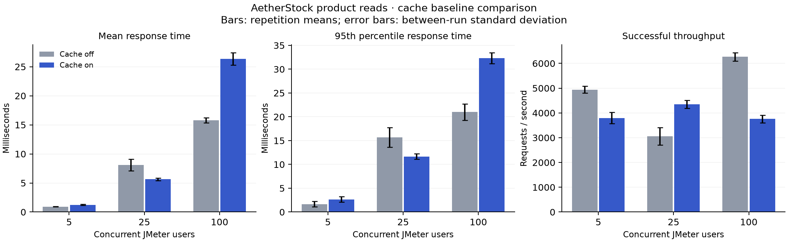

# JMeter product cache comparison

Run: `20261024-130716-cache`. Base revision: `943488aa54ae8efb9f329db99397247a4f0bed50` (see recorded working-tree state and jar SHA).

Dataset: 1000 products. 30 steady seconds per run, 5 second ramp excluded, 3 repetitions. Limiter off; stock reads remain authoritative.

| Users | Cache | Repeats | Requests | Mean ms | p95 ms | Successful req/s | Error % | Cache hit % | DB reads/request |
| ---: | --- | ---: | ---: | ---: | ---: | ---: | ---: | ---: | ---: |
| 5 | off | 3 | 444703 | 0.935 | 1.667 | 4941.1 | 0.00 | N/A | 1.0000 |
| 5 | on | 3 | 341866 | 1.246 | 2.667 | 3798.5 | 0.00 | 100.00 | 0.0000 |
| 25 | off | 3 | 275168 | 8.107 | 15.667 | 3057.4 | 0.00 | N/A | 1.0000 |
| 25 | on | 3 | 391153 | 5.644 | 11.667 | 4346.1 | 0.00 | 100.00 | 0.0000 |
| 100 | off | 3 | 564177 | 15.779 | 21.000 | 6268.6 | 0.00 | N/A | 1.0000 |
| 100 | on | 3 | 338146 | 26.364 | 32.333 | 3757.2 | 0.00 | 100.00 | 0.0000 |

## Interpretation and scope

Cache hits and database loads are counted around each complete JMeter run, including ramp; latency, throughput and resources use only the steady measurement window. Raw samples are retained losslessly as .jtl.gz files.
Cold-Redis population and JVM warm-up are recorded separately. Cold Redis is not cold MongoDB: the product working set is local and warmed by seeding/reads.
All modes use the same HTTP endpoint, product CSV, response-code assertion and product ID/SKU assertions. A cache failure invalidates an ordinary baseline run.
CPU percentages in summary.csv are shares of total host logical-CPU capacity. Per-core CPU and RSS observations are in each resources.csv. Backend, MongoDB, Redis and JMeter are measured separately.
Two backend JVMs remain running, with one receiving benchmark traffic at a time. The shared MongoDB instance and background applications limit conclusions about isolated server capacity.
This experiment does not measure stock-read cache freshness: stock reads bypass Redis. freshness-check.json checks sequential product metadata invalidation only, not all concurrent cache races.
A local cache can reduce database reads without improving HTTP latency; both Redis and MongoDB use this same machine. Report observed results without assuming a speedup.
The 3-workload cache experiment is one part of the lab evaluation. Rate limiting, stock-write contention, shard addition/removal, ID generation and autocomplete require their own workload/baseline comparisons.

## Redis outage and recovery

Separate 5-user failure scenario; these points are excluded from the cache comparison above.

| State | Requests | Mean ms | p95 ms | Successful req/s | Error % | DB reads/request |
| --- | ---: | ---: | ---: | ---: | ---: | ---: |
| outage | 15 | 4049.07 | 4082.00 | 1.2 | 0.00 | 1.0000 |
| recovery | 36943 | 1.22 | 2.00 | 3792.5 | 0.00 | 0.0000 |

Product responses were checked throughout. During the outage Redis lookup/write failures are expected and counted; product reads fall back to MongoDB. Recovery includes a separate warm-up. This is a cache failure, not a database failover or shard failure test.
