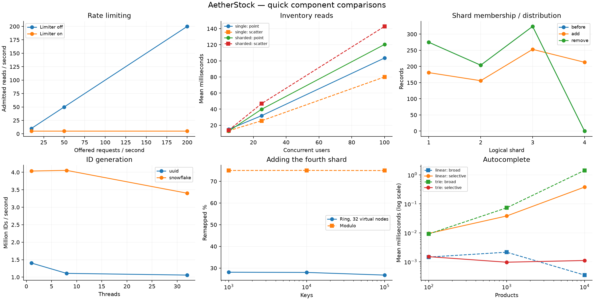

# Component evaluation results

Run everything from the project root:

```powershell
powershell -ExecutionPolicy Bypass -File scripts/test-components.ps1
```

Use `-Only limiter`, `-Only shards`, `-Only stock`, `-Only ids`, `-Only hash` or `-Only autocomplete` to reproduce one experiment.

Settings: 10 measured seconds, 1 repeat(s), 5/25/100 HTTP users by default. This is a quick local comparison. See [the instructions](../../QUICK-TESTS.md) for setup and longer runs.

## 1. Rate limiter off versus on

All threads in each run share one client bucket: capacity 10, refill 5/sec. The measurement excludes five warm-up seconds. Expected 429 responses are rejections, not successful product reads.

| Mode | Users | Offered/s | Actual/s | Admitted/s | Admitted p95 ms | Rejected % | Pacing p95 lag ms | Unexpected errors |
| --- | --- | --- | --- | --- | --- | --- | --- | --- |
| off | 5 | 10 | 10.00 | 10.00 | 11.00 | 0.00 | 9.10 | 0 |
| off | 25 | 50 | 50.00 | 50.00 | 18.00 | 0.00 | 16.00 | 0 |
| off | 100 | 200 | 200.00 | 200.00 | 41.00 | 0.00 | 42.00 | 0 |
| on | 5 | 10 | 10.00 | 5.00 | 20.55 | 50.00 | 5.05 | 0 |
| on | 25 | 50 | 50.00 | 5.00 | 55.10 | 90.00 | 20.05 | 0 |
| on | 100 | 200 | 200.00 | 5.00 | 115.45 | 97.50 | 50.05 | 0 |

## 2. Single database versus three logical shards

Both have 100 products × 5 warehouses and 1,000 units per record. Requests alternate point lookups and product-wide queries. Cache and limiter are off. Shards share one MongoDB process; this measures routing/query overhead, not physical scale-out.

| Mode | Users | Point mean ms | Point p95 ms | Scatter mean ms | Scatter p95 ms | Accepted reads/s | Unexpected errors |
| --- | --- | --- | --- | --- | --- | --- | --- |
| single DB | 5 | 14.93 | 24.00 | 13.21 | 21.00 | 330.00 | 0 |
| single DB | 25 | 31.85 | 45.00 | 25.57 | 36.00 | 847.40 | 0 |
| single DB | 100 | 103.57 | 126.00 | 80.03 | 100.00 | 1067.60 | 0 |
| 3 logical shards | 5 | 12.71 | 18.00 | 13.84 | 20.00 | 351.30 | 0 |
| 3 logical shards | 25 | 39.83 | 53.00 | 46.83 | 63.00 | 564.60 | 0 |
| 3 logical shards | 100 | 120.38 | 160.00 | 142.83 | 187.00 | 743.80 | 0 |

## 3. Stock consistency under concurrent orders

Each case sends 100 one-unit orders. Distributed sales use 100 distinct stock records, each initially 1,000 units. Hot-stock orders share one record containing only 10 units. No automatic retries are hidden in these counts.

| Case | Mode | Users | Reserved orders | Insufficient stock | Retryable writes | Reserved orders/s | Final reserved units | Order/audit/stock match |
| --- | --- | --- | --- | --- | --- | --- | --- | --- |
| distributed-sales | single DB | 5 | 100 | 0 | 0 | 72.15 | 100 | True |
| hot-stock | single DB | 5 | 10 | 50 | 40 | 15.77 | 10 | True |
| distributed-sales | single DB | 25 | 100 | 0 | 0 | 183.49 | 100 | True |
| hot-stock | single DB | 25 | 5 | 0 | 95 | 9.31 | 5 | True |
| distributed-sales | single DB | 100 | 100 | 0 | 0 | 212.31 | 100 | True |
| hot-stock | single DB | 100 | 4 | 0 | 96 | 20.10 | 4 | True |
| distributed-sales | 3 logical shards | 5 | 100 | 0 | 0 | 80.13 | 100 | True |
| hot-stock | 3 logical shards | 5 | 10 | 50 | 40 | 15.24 | 10 | True |
| distributed-sales | 3 logical shards | 25 | 100 | 0 | 0 | 164.20 | 100 | True |
| hot-stock | 3 logical shards | 25 | 6 | 0 | 94 | 11.56 | 6 | True |
| distributed-sales | 3 logical shards | 100 | 100 | 0 | 0 | 196.85 | 100 | True |
| hot-stock | 3 logical shards | 100 | 2 | 0 | 98 | 8.06 | 2 | True |

Retryable write conflicts mean the database safely rejected competing transactions; they do not imply stock was exhausted. Without retries a burst can reserve fewer than 10 units. Every saved `stock-check.json` reconciles persisted stock with returned orders and reservation audits. Global MongoDB snapshots additionally check for orphan orders/audits, invalid stock and duplicate/wrong physical owners.

## 4. Add and remove a shard during read traffic

Full documents preserved: **803**. Duplicate stock copies: **0**. Maximum observed HTTP latency: **3026 ms**.

| Change | Scanned records | Moved records | Remapped % | Server migration ms | Overlapping requests |
| --- | --- | --- | --- | --- | --- |
| add | 803 | 213 | 26.53 | 2934 | 65 |
| remove | 803 | 213 | 26.53 | 2774 | 46 |

HTTP outcomes: `{'accepted': 7162, 'migration_conflict': 50}`. A `migration_conflict` is an explicit retryable 409 from a transaction whose snapshot predates the new routing; it is not counted as an admitted read. Other HTTP/assertion errors: 0.

The final stock documents, versions, timestamps, reservations, orders and audits match the before snapshot exactly. The source remained reachable during graceful removal; this is not a physical shard-failure or failover test.

## 5. Snowflake versus full UUID generation

250,000 IDs per point; actual application Snowflake shared across threads. Generation is timed after warm-up; collision checking is outside that timed region. These are direct Java microbenchmarks.

| Generator | Threads | Repeat | IDs/s | Collisions | Process CPU ms | Mean ID length |
| --- | --- | --- | --- | --- | --- | --- |
| uuid | 1 | 1 | 1403997 | 0 | 578.12 | 42 |
| snowflake | 1 | 1 | 4035454 | 0 | 234.38 | 24 |
| uuid | 8 | 1 | 1108192 | 0 | 656.25 | 42 |
| snowflake | 8 | 1 | 4054611 | 0 | 187.50 | 24 |
| uuid | 32 | 1 | 1059173 | 0 | 671.88 | 42 |
| snowflake | 32 | 1 | 3401444 | 0 | 265.62 | 24 |

Controlled fixed-clock node check: `{'distinct_node_ids': 0, 'duplicate_node_ids': 1000}`. Duplicate-node collisions are intentional misconfiguration, not collisions in the normal benchmark.

## 6. Hashing baseline and distribution

The actual ring is compared with SHA256(key) modulo shard count. Virtual-node and key-count levels use identical deterministic keys. Hot traffic is an explicit simulation: 80% targets one key.

| Keys | Virtual nodes | Ring add remap % | Modulo add remap % | Record imbalance (CV) | Record counts |
| --- | --- | --- | --- | --- | --- |
| 1000 | 1 | 40.30 | 75.00 | 0.726 | {'shard-1': 648, 'shard-2': 293, 'shard-3': 59} |
| 1000 | 32 | 28.10 | 75.00 | 0.104 | {'shard-1': 343, 'shard-2': 287, 'shard-3': 370} |
| 1000 | 128 | 24.80 | 75.00 | 0.034 | {'shard-1': 334, 'shard-2': 319, 'shard-3': 347} |
| 10000 | 1 | 39.31 | 75.05 | 0.708 | {'shard-1': 6393, 'shard-2': 2958, 'shard-3': 649} |
| 10000 | 32 | 28.00 | 75.05 | 0.119 | {'shard-1': 3400, 'shard-2': 2819, 'shard-3': 3781} |
| 10000 | 128 | 26.39 | 75.05 | 0.097 | {'shard-1': 2950, 'shard-2': 3310, 'shard-3': 3740} |
| 100000 | 1 | 39.20 | 74.96 | 0.719 | {'shard-1': 64425, 'shard-2': 29490, 'shard-3': 6085} |
| 100000 | 32 | 26.77 | 74.96 | 0.126 | {'shard-1': 34499, 'shard-2': 27715, 'shard-3': 37786} |
| 100000 | 128 | 25.90 | 74.96 | 0.101 | {'shard-1': 29647, 'shard-2': 32573, 'shard-3': 37780} |

The detailed JSON includes the hot-key request distribution. More balanced record placement cannot split a single hot inventory key across owners. Removing the newly added fourth shard moves its keys back to the original owners.

## 7. Trie versus linear autocomplete

Both use the same token-prefix semantics and complete catalogue. Timing uses an external high-resolution clock around the actual top-8 lookup. Full candidate sets are compared separately; returned order has no ranking contract. These Node timings exclude HTTP and browser rendering.

| Products | Prefix | Repeat | Linear mean ms | Trie mean ms | Linear p95 ms | Trie p95 ms | Candidate-set accuracy |
| --- | --- | --- | --- | --- | --- | --- | --- |
| 100 | broad | 1 | 0.0015 | 0.0091 | 0.0024 | 0.0141 | 100.0% |
| 100 | selective | 1 | 0.0095 | 0.0015 | 0.0092 | 0.0015 | 100.0% |
| 100 | missing | 1 | 0.0017 | 0.0005 | 0.0020 | 0.0005 | 100.0% |
| 1000 | broad | 1 | 0.0021 | 0.0730 | 0.0038 | 0.1433 | 100.0% |
| 1000 | selective | 1 | 0.0381 | 0.0010 | 0.0496 | 0.0010 | 100.0% |
| 1000 | missing | 1 | 0.0154 | 0.0002 | 0.0192 | 0.0003 | 100.0% |
| 10000 | broad | 1 | 0.0003 | 1.4315 | 0.0005 | 2.9160 | 100.0% |
| 10000 | selective | 1 | 0.3798 | 0.0011 | 0.5343 | 0.0013 | 100.0% |
| 10000 | missing | 1 | 0.4859 | 0.0011 | 0.9667 | 0.0010 | 100.0% |

| Products | Linear build ms | Trie build ms | Approx linear heap growth MiB | Approx Trie heap growth MiB |
| --- | --- | --- | --- | --- |
| 100 | 0.46 | 1.45 | 0.30 | 0.69 |
| 1000 | 2.49 | 16.71 | 1.11 | 2.84 |
| 10000 | 21.39 | 1348.00 | 8.74 | 12.73 |

Heap growth includes temporary allocations and GC effects; it is not retained object size. Precision of returned matches and top-8 result counts were also checked, with all checks passing.

## Graphs

Chart points are means across repetitions; tables retain each run.



## Resource observations

Representative 100-user runs. CPU is a percentage of total host logical-CPU capacity; RSS is the peak observed in that run. MongoDB usage includes any other clients of the shared process.

| Experiment | Mode | Backend CPU % | Backend RSS MiB | MongoDB CPU % | MongoDB RSS MiB | JMeter CPU % | JMeter RSS MiB |
| --- | --- | --- | --- | --- | --- | --- | --- |
| limiter | off | 1.73 | 448.57 | 1.06 | 138.91 | 4.69 | 289.54 |
| inventory-reads | single DB | 14.96 | 457.35 | 27.21 | 171.36 | 17.39 | 296.85 |
| distributed-sales | single DB | 10.18 | 457.96 | 10.02 | 173.93 | 29.16 | 257.79 |
| hot-stock | single DB | N/A | N/A | N/A | N/A | N/A | N/A |
| inventory-reads | 3 logical shards | 15.54 | 453.56 | 28.35 | 172.09 | 13.83 | 302.11 |
| distributed-sales | 3 logical shards | 10.03 | 454.85 | 11.53 | 175.71 | 29.95 | 256.64 |
| hot-stock | 3 logical shards | 0.00 | 454.85 | 0.00 | 175.38 | 38.92 | 268.57 |
| limiter | on | 3.97 | 394.00 | 0.57 | 177.14 | 5.42 | 298.43 |

The whole ID benchmark JVM peaked at 325.76 MiB RSS; per-point generation CPU time is reported above.

The autocomplete process peaked at 156.56 MiB RSS. Its query CPU times and approximate build allocation growth are retained in autocomplete.json. Test fixtures index each complete generated catalogue; this does not change the application's initial catalogue fetch limit.

## Evidence and limitations

Exact settings/hashes: `manifest.json`. HTTP summaries: `http-summary.csv` and `http-results.json`. Each run keeps its command, dataset, per-process CPU/RSS observations and compressed raw JTL. Algorithm files include CPU/build/memory observations. Measured HTTP counts exclude warm-up and tail samples; server shard-operation deltas include the whole run and count database operations, including scatter fan-out.

Short runs and fresh load-generator JVMs limit performance conclusions. Existing apps remain running on the shared host. Repeat with `-Seconds 60 -Repeats 3` for a longer study. One MongoDB deployment backs all logical shards. Transaction/order data is still in the core database; partitioning it remains an explicit requirement gap. Reservation expiry is deferred.

