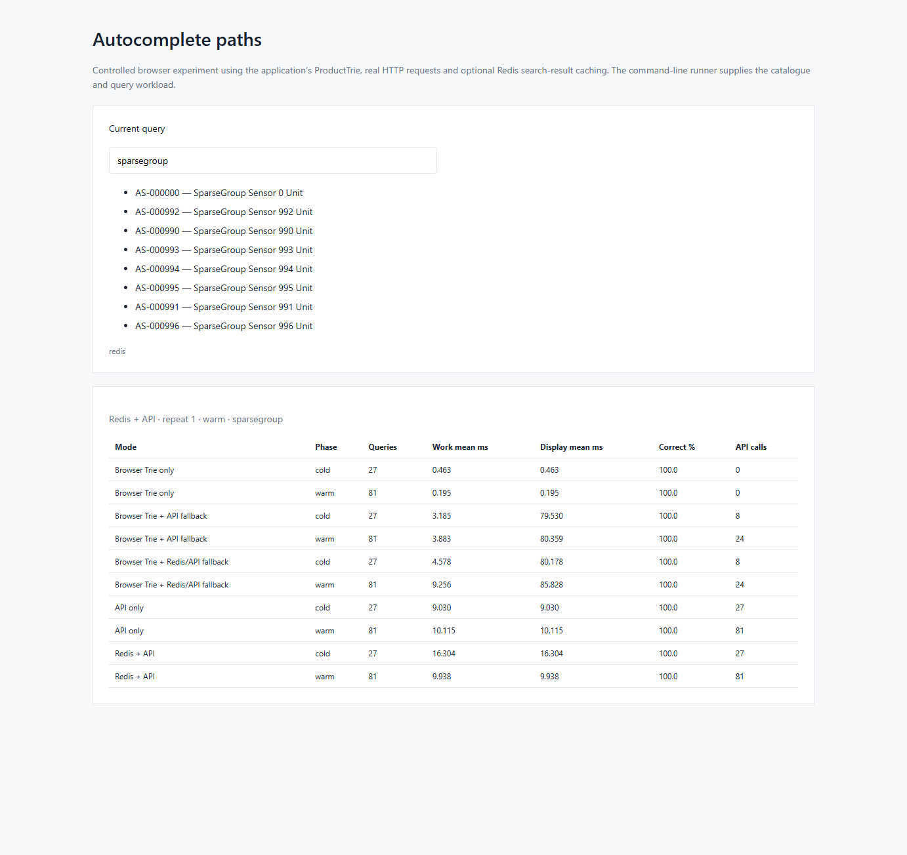
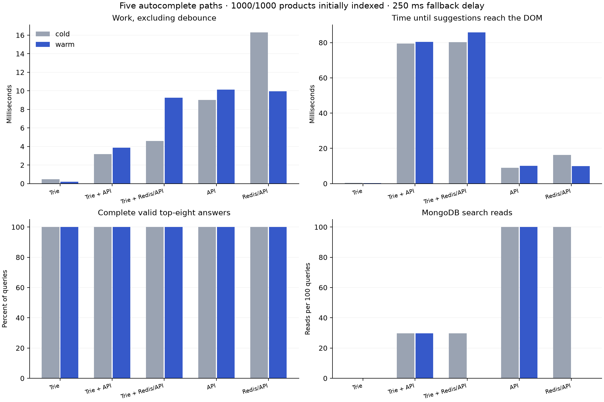

# Five autocomplete paths in Chrome

Catalogue: 1000; initial browser index: 1000; 1 independent repetitions; 27 queries per cold pass, 3 repeated warm passes; debounce: 250 ms.

Cache means a dedicated Redis search-result cache. All modes use the same token-prefix rules and top-eight limit. HTTP browser caching is disabled. The normal product search endpoint and operational UI are unchanged. This opt-in API queries a MongoDB token projection with a multikey token index.

| Mode | Phase | Queries | Work mean ms | Work p95 ms | Display mean ms | Correct queries % | Valid result fill % | API calls | Mongo reads | Redis hits |
| --- | --- | ---: | ---: | ---: | ---: | ---: | ---: | ---: | ---: | ---: |
| Browser Trie only | cold | 27 | 0.463 | 1.350 | 0.463 | 100.0 | 100.0 | 0 | 0 | 0 |
| Browser Trie only | warm | 81 | 0.195 | 0.400 | 0.195 | 100.0 | 100.0 | 0 | 0 | 0 |
| Browser Trie + fallback | cold | 27 | 3.185 | 12.280 | 79.530 | 100.0 | 100.0 | 8 | 8 | 0 |
| Browser Trie + fallback | warm | 81 | 3.883 | 14.700 | 80.359 | 100.0 | 100.0 | 24 | 24 | 0 |
| Browser Trie + Redis + fallback | cold | 27 | 4.578 | 15.130 | 80.178 | 100.0 | 100.0 | 8 | 8 | 0 |
| Browser Trie + Redis + fallback | warm | 81 | 9.256 | 33.800 | 85.828 | 100.0 | 100.0 | 24 | 0 | 24 |
| API only | cold | 27 | 9.030 | 12.340 | 9.030 | 100.0 | 100.0 | 27 | 27 | 0 |
| API only | warm | 81 | 10.115 | 14.700 | 10.115 | 100.0 | 100.0 | 81 | 81 | 0 |
| Redis + API | cold | 27 | 16.304 | 20.750 | 16.304 | 100.0 | 100.0 | 27 | 27 | 0 |
| Redis + API | warm | 81 | 9.938 | 12.300 | 9.938 | 100.0 | 100.0 | 81 | 0 | 81 |

## How to read this

Work time includes Trie lookup, actual fetch/JSON parsing if used, incremental indexing and DOM/layout update; it excludes deliberate debounce waiting. Display time includes that waiting, starting from the completed-query input event. Neither metric claims to measure pixels reaching a physical screen.
Initial catalogue download and Trie construction are recorded separately in each point. Browser-only means no API search per query; the initial index still needs catalogue data.
Cold starts with a new browser index and a unique empty Redis query namespace. Warm repeats the same queries in the same client. Positive API results are added to the Trie, so repeated positive fallbacks can become local hits. Negative results remain empty locally; Redis can cache those empty lists.
Correct query means every returned product is a valid token-prefix match and the number returned equals min(8, full-catalogue matches). Fill compares valid returned counts with that expected top-eight count. No ranking/order equivalence is claimed. Empty Trie results for unloaded matching products count as incomplete, not successful fast answers.
Query classes: 8 initially indexed SKU prefixes, 8 deeper-catalogue SKU prefixes, 8 absent prefixes, 2 broad prefixes, and one partial-local prefix with one indexed match and ten outside the original 100. Zero-hit fallback does not fetch more when a local match already exists; its incomplete result is measured rather than hidden. See queries.csv for each class and phase. Expected sets are computed outside timed search work.
The server has a warm-up before measured requests; cold refers to data caches, not cold process/OS/disk. Mode order rotates across repetitions. One actual Chrome tab sends sequential completed-query events. This is not a JMeter concurrency test, a keystroke cancellation test, or the React component itself.
The catalogue is immutable during measurement. Snapshot revision and run tokens isolate Redis keys; all keys expire after five minutes. This does not implement normal product-edit search-cache invalidation.
resources.csv samples backend, MongoDB, Redis, driver and Chrome. Chrome RSS sums its process tree and can count shared pages repeatedly; browser heap includes the oracle and harness. Source hashes and settings are in manifest.json; browser version is saved separately.

Reproduce: `powershell -ExecutionPolicy Bypass -File scripts/test-autocomplete-five.ps1`. Change `-Initial 1000` to compare a fully loaded browser index.

## Comparison graphs

Bars pool the recorded queries from the independent repetitions. These are descriptive measurements, not confidence intervals. Cold means a fresh index/query namespace; warm means repeated queries in the same client.

## Warm queries by class

| Mode | Query class | Work mean ms | Display mean ms | Complete answers % | API calls |
| --- | --- | ---: | ---: | ---: | ---: |
| Trie | initial | 0.308 | 0.308 | 100.0 | 0 |
| Trie | deeper | 0.121 | 0.121 | 100.0 | 0 |
| Trie | missing | 0.075 | 0.075 | 100.0 | 0 |
| Trie | broad | 0.450 | 0.450 | 100.0 | 0 |
| Trie | partial_local | 0.333 | 0.333 | 100.0 | 0 |
| Trie + API | initial | 0.729 | 0.729 | 100.0 | 0 |
| Trie + API | deeper | 0.600 | 0.600 | 100.0 | 0 |
| Trie + API | missing | 11.142 | 269.250 | 100.0 | 24 |
| Trie + API | broad | 1.950 | 1.950 | 100.0 | 0 |
| Trie + API | partial_local | 1.167 | 1.167 | 100.0 | 0 |
| Trie + Redis/API | initial | 0.287 | 0.287 | 100.0 | 0 |
| Trie + Redis/API | deeper | 0.217 | 0.217 | 100.0 | 0 |
| Trie + Redis/API | missing | 30.417 | 288.850 | 100.0 | 24 |
| Trie + Redis/API | broad | 0.817 | 0.817 | 100.0 | 0 |
| Trie + Redis/API | partial_local | 0.900 | 0.900 | 100.0 | 0 |
| API | initial | 12.300 | 12.300 | 100.0 | 24 |
| API | deeper | 9.233 | 9.233 | 100.0 | 24 |
| API | missing | 8.092 | 8.092 | 100.0 | 24 |
| API | broad | 11.550 | 11.550 | 100.0 | 6 |
| API | partial_local | 13.000 | 13.000 | 100.0 | 3 |
| Redis/API | initial | 9.567 | 9.567 | 100.0 | 24 |
| Redis/API | deeper | 10.088 | 10.088 | 100.0 | 24 |
| Redis/API | missing | 9.725 | 9.725 | 100.0 | 24 |
| Redis/API | broad | 11.483 | 11.483 | 100.0 | 6 |
| Redis/API | partial_local | 10.333 | 10.333 | 100.0 | 3 |

## Bootstrap and cache costs

| Mode | Initial download mean ms | Trie construction mean ms | Warm Redis lookup mean ms |
| --- | ---: | ---: | ---: |
| Trie | 64.300 | 45.800 | N/A |
| Trie + API | 22.200 | 26.600 | N/A |
| Trie + Redis/API | 27.800 | 102.600 | 2.162 |
| API | 0.000 | 0.000 | N/A |
| Redis/API | 0.000 | 0.000 | 2.492 |

## Whole-workload process resources

| Process | Mean host CPU % | Peak RSS MiB |
| --- | ---: | ---: |
| chrome | 5.95 | 760.50 |
| driver | 0.15 | 48.69 |
| redis | 0.02 | 38.50 |
| mongodb | 0.52 | 135.27 |
| backend | 1.68 | 416.01 |

Resources cover the workload as a whole, including browser control/GC and shared MongoDB background work. Chrome sums its process tree; shared pages may be counted repeatedly. No per-mode CPU comparison is inferred from this table.
